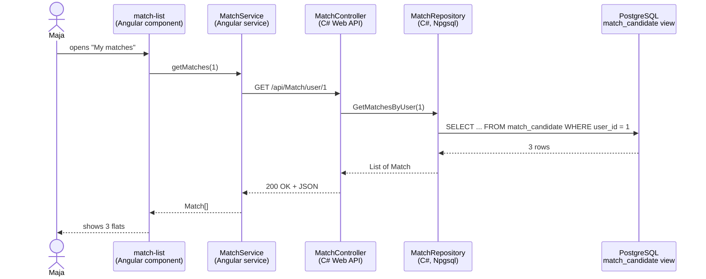

# RentWatch docs

Start here. This folder explains how RentWatch is built and what each of us builds to.

## What's in this folder

| File | What it is | Read it when |
|---|---|---|
| [overview.md](overview.md) | Drawing of the whole system and who owns each part | You're new to the project |
| [er-diagram.md](er-diagram.md) | The database tables and how they relate | You need to know where data lives |
| [api-contract.md](api-contract.md) | Every API endpoint, the JSON it takes and returns, and the allowed values | You're building the API or the Angular services |
| [backend-queries.md](backend-queries.md) | The tested SQL behind every endpoint, ready to paste into the repositories | You're writing a repository |
| [requirements-checklist.md](requirements-checklist.md) | Every exam requirement and what covers it | Planning work, or checking we're done |

The `.png` files are the same drawings as images, for the report (`request-flow.png` is the drawing below).

## How one request travels

Example: Maja opens "My matches" in the app.

Every feature follows the same path. Each layer only talks to the one next to it:

1. **Component** shows the page and reacts to clicks. Built by Rose and Niklas, from `api-contract.md`.
2. **Service** turns a click into an HTTP request. Built by Rose and Niklas, from `api-contract.md`.
3. **Controller** receives the request and picks the right repository method. Built by Rose and Niklas, from `api-contract.md`.
4. **Repository** runs the SQL. Built by Rose and Niklas, with SQL from `backend-queries.md`.
5. **Database** stores the data and works out matches. Built by Elliott, see `er-diagram.md`.

## Order to build in

1. Get the database running locally (see the main README).
2. Backend: one controller at a time, starting with `Provider` (simplest), then `Listing`, `WatchProfile`, `Match`. Test each in Swagger or Postman.
3. Frontend: services first, then the components that use them.
4. Tick off `requirements-checklist.md` as each piece is merged.
