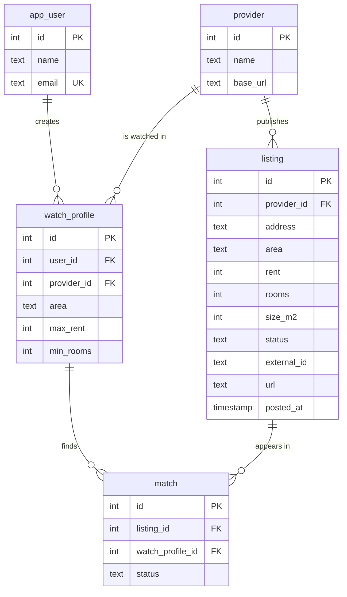

# RentWatch E-R diagram

Matches `database/schema.sql`. `er-diagram.png` is the same diagram as an image for the report.

## Relationships

| From | To | Type | On delete |
|---|---|---|---|
| app_user | watch_profile | One user has many watch profiles | Deleting a user deletes their profiles |
| provider | listing | One provider has many listings | Blocked while listings exist |
| provider | watch_profile | One provider is watched by many profiles | Blocked while profiles exist |
| listing | match | One listing can match many profiles | Deleting a listing deletes its matches |
| watch_profile | match | One profile can have many matches | Deleting a profile deletes its matches |

`match` links `listing` and `watch_profile` many-to-many. A listing and profile pair can only match once.

## Rules enforced by the database

- `app_user.email` is unique.
- `listing`: rent > 0, rooms 1 to 6, size_m2 > 0, status is available, reserved or rented, and `external_id` is unique per provider.
- `watch_profile`: max_rent > 0, min_rooms 1 to 6.
- `match.status` is new, seen or applied, and defaults to new.
