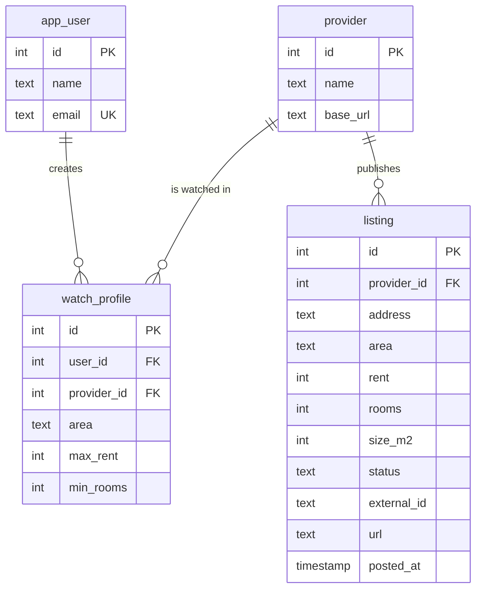

# RentWatch E-R diagram

Matches `database/schema.sql`. `er-diagram.png` is the same diagram as an image for the report.

## Relationships

| From | To | Type | On delete |
|---|---|---|---|
| app_user | watch_profile | One user has many watch profiles | Deleting a user deletes their profiles |
| provider | listing | One provider has many listings | Blocked while listings exist |
| provider | watch_profile | One provider is watched by many profiles | Blocked while profiles exist |

## Matching

Matches are not stored. The view `match_candidate` works them out on every query: a listing matches a watch profile when it is available, comes from the profile's provider, is in the profile's area, costs no more than `max_rent` and has at least `min_rooms`.

## Rules enforced by the database

- `app_user.email` is unique.
- `listing`: rent > 0, rooms 1 to 6, size_m2 > 0, status is available, reserved or rented, and `external_id` is unique per provider.
- `watch_profile`: max_rent > 0, min_rooms 1 to 6.
