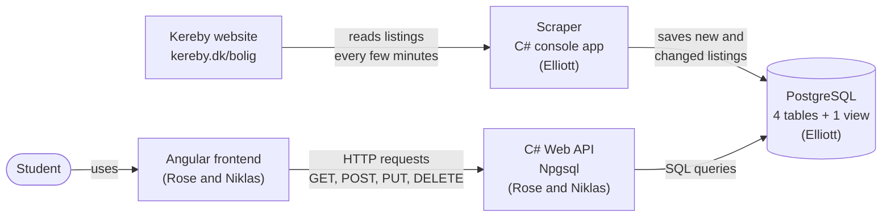

# RentWatch overview

How the parts of RentWatch fit together. `overview.png` is the same drawing as an image for the report.

## The parts

| Part | Job | Owner |
|---|---|---|
| Scraper | Reads Kereby's listings page and saves each listing to the database | Elliott |
| PostgreSQL | Stores users, providers, listings and watch profiles. The `match_candidate` view works out which listings fit which profiles | Elliott |
| C# Web API | Gives the frontend CRUD endpoints for listings and watch profiles, and returns each user's matches | Rose and Niklas |
| Angular frontend | Lets students browse listings, create and edit watch profiles, and see their matches | Rose and Niklas |

The app also works without the scraper: the seed data fills the database with test listings.

See `er-diagram.md` for the database design.
